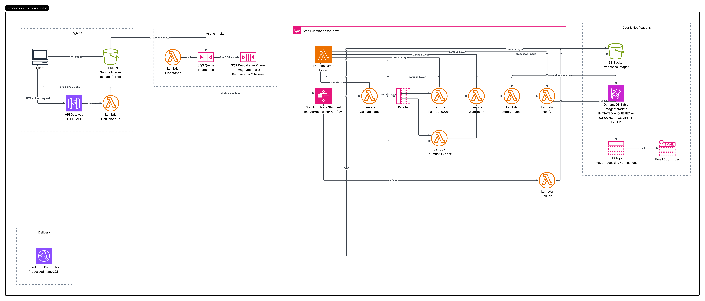

# AWS Serverless Image Processing Pipeline

An event-driven, fully serverless image processing pipeline built with **AWS SAM**.
Images uploaded to a source S3 bucket are decoupled through **SQS**, processed by
**Step Functions-orchestrated Lambdas** (validate → resize → watermark → store),
tracked in **DynamoDB**, delivered globally through **CloudFront**, and reported
via **SNS** — with a **DLQ** absorbing poison messages.

## Solution Overview

| Capability | How it's implemented |
|---|---|
| Upload | API Gateway (HTTP API) endpoint returns **S3 pre-signed PUT URLs** |
| Event ingestion | Source bucket **S3 event notification** → **SQS** queue |
| Resilience | SQS **decouples** upload from processing; redrive policy (3 attempts) → **DLQ** + CloudWatch alarm |
| Processing | **Step Functions** Standard workflow: `ValidateImage → (Thumbnail ∥ FullRes) → Watermark → StoreMetadata → Notify`, with `FailJob` catch-all |
| Image libraries | **Pillow** packaged in a **Lambda Layer** (arm64 / Graviton) |
| Metadata | **DynamoDB** table with a traceable status lifecycle per image |
| Delivery | **CloudFront** + **Origin Access Control** (bucket stays private), edge caching with immutable `Cache-Control` |
| Notifications | **SNS** topic for job completion and failure, optional email subscription |
| Storage hygiene | **S3 Lifecycle rules** on the source bucket (30d → Standard-IA, 90d → expire) |

## Architecture



```
 ┌────────┐  POST /images/presign  │  ┌──────────────┐   PUT    ┌────────────────────┐           │
 │ Client │──────────────────────▶│  │ API Gateway  │          │  Source Bucket     │           │
 └────────┘◀─── pre-signed URL ────│  │  (HTTP API)  │          │  /uploads/…        │           │
     │                             │  └──────┬───────┘          └─────────┬──────────┘           │
     │ PUT image ───────────────────────────────────────────────────▶   ObjectCreated:* │           │
     │                             │         │  Lambda: Presign          ▼                       │
     │                             │         ▼                    ┌──────────┐   redrive   ┌─────┐
     │                             │    ┌───────────┐             │  SQS     ├────────────▶│ DLQ │
     │                             │    │ DynamoDB  │             │  queue   │  (3 tries)  └─────┘
     │                             │    │ metadata  │◀────┐       └────┬─────┘                     │
     │                             │    └───────────┘     │            ▼ poll (batch 10)         │
     │                             │                      │      ┌────────────┐                  │
     │                             │                      │      │  Lambda:   │ StartExecution   │
     │                             │                      │      │ Dispatcher │──────────┐       │
     │                             │                      │      └────────────┘          ▼       │
     │                             │                      │            ┌───────────────────────────────┐
     │                             │                      │            │ Step Functions                │
     │                             │                      │            │  Validate ──┬─ Thumbnail ─┐   │
     │                             │                      │            │             │  Full-res   │   │  (Parallel)
     │                             │                      │            │             └──── Watermark│   │
     │                             │                      │            │      → StoreMetadata → Notify │
     │                             │                      │            └───────┬───────────┬───────────┘
     │                             │                      │                    ▼           ▼
     │                             │                 ┌────┴─────┐      ┌────────────┐ ┌─────┐
     │                             │                 │ DynamoDB │      │ Dest Bucket│ │ SNS │──▶ email
     │                             │                 └──────────┘      └─────┬──────┘ └─────┘
     │                             │                                         │ origin (OAC)
     │                             │                                         ▼
     │                             │                                  ┌─────────────┐
     └──────────────────────────────┼─────────────────────────────────▶│  CloudFront │──▶ global viewers
                                    │                                  └─────────────┘             │
                                    └─────────────────────────────────────────────────────────────┘
```

### Image status lifecycle (DynamoDB)

`INITIATED` (pre-sign issued) → `QUEUED` (dispatcher picked it up) →
`PROCESSING` (validation passed) → `COMPLETED` | `FAILED`

## How It Works

1. **Upload.** A client calls `POST /images/presign` with a filename and content
   type. The Lambda validates the content type (jpeg/png/webp only), creates a
   DynamoDB item (`INITIATED`) and returns a pre-signed PUT URL valid for 10 minutes.
2. **Ingest.** The client PUTs the image to the source bucket under
   `uploads/<imageId>/<filename>`. The bucket's **event notification** publishes
   `ObjectCreated:*` for the `uploads/` prefix to the SQS queue.
3. **Decouple.** SQS buffers events so a processing outage never loses uploads.
   The **Dispatcher** Lambda (event source mapping, batch size 10) marks the image
   `QUEUED` and starts one **Step Functions** execution per image. Messages that
   fail 3 processing attempts are moved to the **DLQ** (with a CloudWatch alarm).
4. **Orchestrate.** The workflow runs
   `ValidateImage` (format/dimensions/readability) → a **Parallel** state running
   `Thumbnail` (256×256 square crop) and `FullRes` (≤1920px) → `Watermark` (text
   burned in via Pillow) → `StoreMetadata` (DynamoDB `COMPLETED`) → `Notify` (SNS).
   Any step failure is caught by `FailJob`, which marks the image `FAILED` and
   notifies SNS. Transient Lambda errors are retried with exponential backoff.
5. **Deliver.** Processed variants land at `processed/<imageId>/{thumbnail,full}.jpg`
   in the destination bucket and are served through **CloudFront** using
   **Origin Access Control** — the bucket stays fully private, and edge caching
   (with `Cache-Control: immutable`) makes repeat reads effectively free.

## Repository Structure

```
├── template.yaml                  # AWS SAM template (all infrastructure)
├── samconfig.toml.example         # SAM CLI config example
├── src/pipeline/                  # All Lambda handlers (Python 3.12)
│   ├── common.py                  #   DynamoDB status + SNS helpers
│   ├── presign.py                 #   API Gateway pre-signed URL endpoint
│   ├── dispatcher.py              #   SQS → Step Functions starter
│   ├── validate.py                #   Step 1: image validation
│   ├── resize.py                  #   Step 2a/2b: thumbnail + full-res
│   ├── watermark.py               #   Step 3: text watermark (Pillow)
│   ├── metadata.py                #   Step 4: store metadata
│   ├── notify.py                  #   Step 5: SNS completion notice
│   └── failure.py                 #   Catch-all: FAILED status + SNS
├── layers/pillow/Makefile         # SAM-built Pillow layer (arm64 wheels)
├── events/s3-event.json           # Sample SQS event for local testing
├── scripts/test-pipeline.sh       # End-to-end smoke test
└── docs/
    └── architecture.png           # Solution architecture diagram
```

## Prerequisites

- An AWS account with permissions to create S3, SQS, Lambda, Step Functions,
  DynamoDB, API Gateway, CloudFront and SNS resources
- [AWS SAM CLI](https://docs.aws.amazon.com/serverless-application-model/latest/developerguide/install-sam-cli.html) ≥ 1.120
- Python 3.12 (or Docker, if you prefer SAM to build the layer in a container)
- AWS CLI configured (`aws configure`)

## Deployment

```bash
cp samconfig.toml.example samconfig.toml   # then edit stack name / region / email
sam build                                  # also builds the Pillow layer
sam deploy --guided                        # first run: accepts defaults & creates roles
```

Notes:
- Deploy to **us-east-1** if you want CloudFront's full feature set alongside the
  console defaults (any region works).
- To receive job notifications, set the `NotificationEmail` parameter during
  `--guided` deployment and confirm the SNS subscription email.
- To customize the watermark, set the `WatermarkText` parameter
  (default `© ImagePipeline`).

The `--guided` deployment prints all outputs (bucket names, API URL,
CloudFront domain, queue URLs, table name). You can list them any time with:

```bash
aws cloudformation describe-stacks --stack-name image-pipeline \
  --query 'Stacks[0].Outputs[].[OutputKey,OutputValue]' --output table
```

## Testing the Pipeline

### One-command smoke test

```bash
./scripts/test-pipeline.sh              # generates a sample image
./scripts/test-pipeline.sh my-photo.jpg # or use your own
```

The script requests a pre-signed URL from the API, uploads the image, polls
DynamoDB until the status is `COMPLETED`, and prints the CloudFront URLs plus
the stored metadata.

### Manual walkthrough

```bash
# 1. Get a pre-signed upload URL
curl -sS -X POST "$API_URL" -H 'Content-Type: application/json' \
  -d '{"filename": "photo.jpg", "contentType": "image/jpeg"}'

# 2. Upload the image
curl -X PUT "$UPLOAD_URL" -H 'Content-Type: image/jpeg' --data-binary @photo.jpg

# 3. Watch it flow through the pipeline
aws sqs get-queue-attributes --queue-url "$QUEUE_URL" \
  --attribute-names ApproximateNumberOfMessages
# DynamoDB: aws dynamodb scan --table-name $TABLE --output table
# S3:       aws s3 ls s3://$DEST_BUCKET/processed/ --recursive
# 4. View through CloudFront
curl -sS -o /dev/null -w '%{http_code} %{time_total}s\n' \
  "https://$CF_DOMAIN/processed/$IMAGE_ID/thumbnail.jpg"
```

### Failure-path testing

- **Invalid file:** upload a text file named `photo.jpg` — `ValidateImage` fails,
  the workflow routes to `FailJob`, DynamoDB shows `FAILED` and SNS publishes.
- **Poison messages:** a message that fails 3 dispatcher attempts lands in the
  DLQ (visible in `DeadLetterQueueUrl` output; the `image-pipeline-dlq-not-empty`
  alarm fires).
- **Local unit check:** `sam local invoke DispatcherFunction -e events/s3-event.json`

## Configuration

| Parameter | Default | Purpose |
|---|---|---|
| `NotificationEmail` | *(empty)* | Email subscribed to job success/failure SNS notifications |
| `WatermarkText` | `© ImagePipeline` | Text burned into processed images |
| `PriceClass` | `PriceClass_100` | CloudFront edge network class (100 = cheapest) |

Environment variables consumed by the Lambdas (`SOURCE_BUCKET`,
`DESTINATION_BUCKET`, `TABLE_NAME`, `TOPIC_ARN`, `WATERMARK_TEXT`,
`STATE_MACHINE_ARN`) are wired automatically by the template.

## Cleanup

```bash
sam delete   # deletes the stack and, because resources use DeletePolicy, the buckets/tables
```

Any objects left in buckets are removed as part of `sam delete`'s prompts.

## Cost

At a modest volume (a few hundred images/day) this stack runs within the AWS
Free Tier limits or for a few dollars a month: Lambda billed per GB-second
(arm64 halves the cost), DynamoDB/S3/SQS priced per-request, and CloudFront's
first 1 TB of egress per month is free. The main recurring costs at scale are
CloudFront egress and Step Functions state transitions.

## Security Considerations

- Both buckets **block all public access**; the destination bucket is readable
  only via CloudFront's **Origin Access Control** with an `AWS:SourceArn`
  condition locking the policy to this distribution.
- Pre-signed URLs are scoped to a single key, content type and 10-minute TTL;
  uploads are restricted to the `uploads/` prefix and allowed content types only.
- Every Lambda uses a least-privilege IAM policy (e.g. the watermark function
  can only touch the destination bucket).
- The HTTP API can be hardened with an authorizer (Cognito/JWT/API keys) before
  any production use.

## Learning Outcomes

- **Event-driven architecture:** S3 event notifications trigger downstream
  processing without polling or blocking the uploader.
- **Why SQS decoupling improves resilience:** uploads succeed even while
  processing is down or throttled; failures retry up to `maxReceiveCount`
  times, then land in a DLQ for inspection instead of being lost.
- **Lambda Layers:** Pillow (~10 MB of native wheels) is packaged once and
  shared by four functions instead of bloating each deployment package.
- **Step Functions orchestration:** visible, retryable, catch-able multi-step
  workflows — including a Parallel state for thumbnail + full-res — with
  per-step error routing to `FailJob`.
- **S3 lifecycle policies:** uploads transition to Standard-IA after 30 days
  and expire after 90, keeping hot source storage cheap.
- **CloudFront delivery:** private origins accessed via OAC, managed
  `CachingOptimized` cache policy, and immutable object caching.

## Troubleshooting

| Symptom | Likely cause / fix |
|---|---|
| Upload returns 403 | Pre-signed URL expired (10 min TTL) or content type mismatch — request a new URL |
| Status stuck at `QUEUED` | Check the Step Functions execution history and the Dispatcher function's CloudWatch logs |
| Status `FAILED` | Read the `error` attribute in DynamoDB; common causes: unsupported format or oversized image |
| Message in DLQ | Inspect with `aws sqs receive-message --queue-url $DLQ_URL`; fix the root cause, then redrive or purge |
| Layer build fails | Ensure Python 3.12 or Docker is available; `sam build` rebuilds `layers/pillow` from its Makefile |
| 403 from CloudFront URL | The object key doesn't exist yet — check the S3 listing first |

## References

- [AWS Solutions — Dynamic Image Transformation for Amazon CloudFront](https://github.com/aws-solutions/dynamic-image-transformation-for-amazon-cloudfront) (structure & content guideline)
- [AWS SAM Developer Guide](https://docs.aws.amazon.com/serverless-application-model/latest/developerguide/what-is-sam.html)
- [Amazon SQS dead-letter queues](https://docs.aws.amazon.com/AWSSimpleQueueService/latest/SQSDeveloperGuide/sqs-dead-letter-queues.html)
- [AWS Step Functions — Standard vs. Express workflows](https://docs.aws.amazon.com/step-functions/latest/dg/concepts-standard-vs-express.html)
- [Restricting Amazon S3 origin access with OAC](https://docs.aws.amazon.com/AmazonCloudFront/latest/DeveloperGuide/private-content-restricting-access-to-s3.html)
- [S3 Lifecycle configuration basics](https://docs.aws.amazon.com/AmazonS3/latest/userguide/object-lifecycle-mgmt.html)
- [Pillow documentation](https://pillow.readthedocs.io/)
